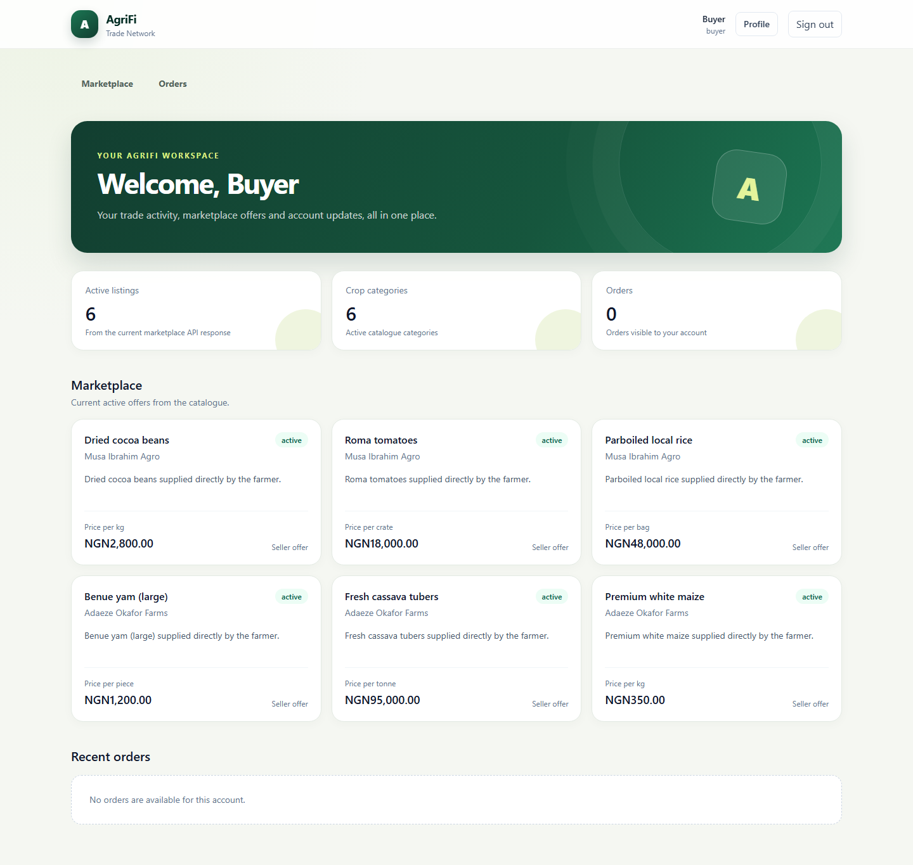
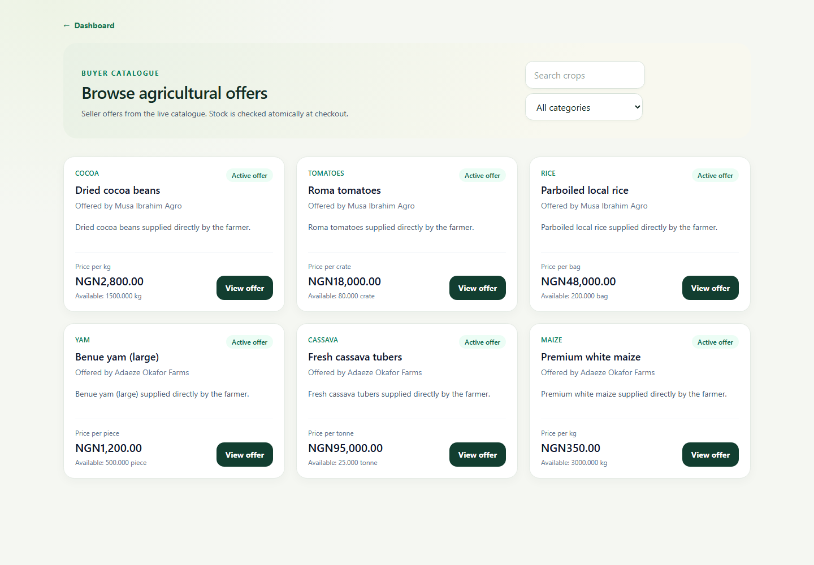
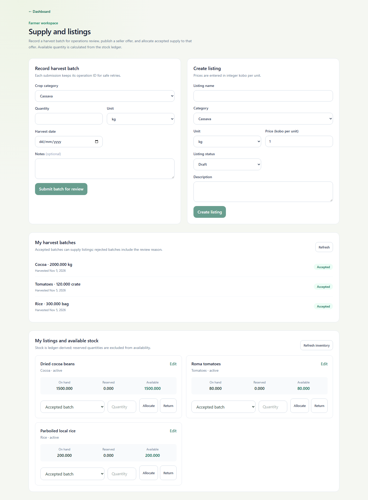

# AgriFi Trade Network

AgriFi is a Nigeria-first B2B agricultural marketplace for farmers, bulk buyers, operations staff, and finance operators. It supports crop listings, harvest submissions, traceable orders, inventory reservations, and auditable payment simulations.

> **Project status (5 November 2026):** the PDF-based MVP completion estimate is about **82%**. Core features and local verification are substantially complete, but this project is not approved for production. See [project status](docs/PROJECT_STATUS.md) for evidence and open work.

## Product boundaries

- The server is authoritative for users, roles, prices, stock, orders, and financial records.
- Stock is derived from an append-only movement ledger and reservation rows.
- The MAUI app can save harvest drafts offline; a draft does not affect shared stock until the server accepts it.
- Payments, refunds, settlements, and ledger postings are **simulated only**. No real funds move and no payment provider is called.
- AgriFi is a marketplace, not an AI agent, crop predictor, lender, blockchain, or automated trader.

## What is implemented

- Django and Django REST Framework modular monolith with a versioned `/api/v1/` API, JWT authentication, role and ownership checks, validation, audit events, and OpenAPI documentation.
- PostgreSQL as the authoritative database, with UUID business identifiers, integer-kobo money, decimal quantities, database constraints, atomic services, and PostgreSQL-backed concurrency tests.
- Farmer, buyer, operations, and finance workflows for accounts, crop categories, listings, harvest batches, orders, disputes, and simulated finance.
- Ledger-derived stock availability, locked reservations, idempotent requests, immutable financial history, and compensating journal entries.
- Angular 22 and Tailwind web dashboard in `web/`.
- .NET MAUI farmer app with SQLite offline outbox and sync logic in `mobile/`.
- Docker Compose for local PostgreSQL/API/scheduler development; GitHub Actions workflows are in `.github/workflows/`.

## Architecture and project status

| Component | Implementation | Current evidence |
|---|---|---|
| Backend | Django/DRF, PostgreSQL, modular domain apps | PostgreSQL 16 suite: 279 passed, 1 skipped; clean migration and trigger checks passed locally |
| Web | Angular + Tailwind | 21 passed, 1 skipped; production build and 5 Chromium journeys passed |
| Mobile core | .NET MAUI Core, SQLite outbox | 48/48 xUnit tests passed; Windows target builds |
| Android | MAUI Android | Build succeeds; sign-in, profile/category loading, validation, session restore, and unavailable-API handling checked on Android 15 API 35 emulator |
| Backup/restore | Disposable PostgreSQL 16 drill | Restore and integrity checks passed for the documented test scenario |

The 82% figure is an estimate against the supplied build specification, not a test result or production-readiness score. Hosted CI has passed for the published commit, including PostgreSQL tests, Angular browser checks/build, MAUI Core tests, and Android compilation. Remaining work includes Android offline capture/sync verification, deployed monitoring and alerting, production configuration, performance evidence, and external accounting/legal review. The simulated chart and settlement/refund semantics remain subject to accountant review.

More detail: [build specification](AgriFi_AI_Agent_Build_Specification.md), [architecture](docs/ARCHITECTURE.md), [decisions](docs/DECISIONS.md), [project status](docs/PROJECT_STATUS.md), [operations](docs/OPERATIONS.md), [production readiness](docs/PRODUCTION_READINESS.md), [accounting review](docs/ACCOUNTING_REVIEW.md), and [API contract](docs/API_CONTRACT.md).

## Web app screenshots

These screens were captured from the Angular app using isolated seeded demo accounts and data.

| Buyer dashboard | Marketplace | Farmer workspace |
|---|---|---|
|  |  |  |

## Local development

### Requirements

- Docker Desktop with Docker Compose for the PostgreSQL-backed API stack.
- Node.js and npm for the Angular app.
- .NET 10 SDK; Android builds additionally require the MAUI Android workload, Android SDK, and JDK 21.

### Start PostgreSQL and the API

From the repository root, make a local environment file and replace its placeholder secrets:

```powershell
Copy-Item .env.example .env
```

Then start the local stack:

```powershell
docker compose up --build
```

Compose starts PostgreSQL 16, applies migrations, then starts the API and maintenance scheduler. The API is at `http://localhost:8000`; `/healthz/` is the liveness endpoint and `/readyz/` checks database readiness. The local dashboard origin `http://localhost:4200` is included in `.env.example` for CORS.

Stop the stack with `docker compose down`. This keeps the local database volume. `docker compose down -v` removes it and deletes local database data.

### Start the Angular dashboard

In a second terminal:

```powershell
cd web
npm ci
npm start
```

Open `http://localhost:4200`. The dashboard uses the local API configured in `web/src/environments/environment.ts`.

### Run the farmer app

Restore/build the MAUI Windows app using the commands in [AGENTS.md](AGENTS.md). For Android, configure `JAVA_HOME`, `ANDROID_HOME`, and `ANDROID_SDK_ROOT`, then build the `net10.0-android` target. The app's API URL can be changed on its sign-in screen; use HTTPS outside local development.

## Verification commands

Run commands from the indicated directory. PostgreSQL is the authority for row-locking and concurrency behavior; SQLite test results do not prove PostgreSQL behavior.

### Django fast suite (SQLite)

From `backend/` in PowerShell:

```powershell
$env:AGRIFI_USE_SQLITE = '1'
$env:DJANGO_DEBUG = 'true'
python manage.py check
python manage.py makemigrations --check --dry-run
python manage.py test
```

### PostgreSQL 16 suite

From the repository root:

```powershell
docker compose -f docker-compose.test.yml up --build --abort-on-container-exit --exit-code-from test
```

### Angular

From `web/`:

```powershell
npm test
npm run build
npm run e2e
```

### MAUI

From the repository root:

```powershell
dotnet test mobile/AgriFi.Mobile.Tests
```

The Windows and Android build commands, including the Android workload properties needed on Windows, are recorded in [AGENTS.md](AGENTS.md).

## Repository layout

```text
backend/       Django API, domain apps, migrations, and backend tests
web/           Angular buyer/operations dashboard and browser tests
mobile/        .NET MAUI app, UI-free Core, and xUnit tests
contracts/     Shared API contract fixtures
docs/          Architecture, API, operations, status, and review records
frontend/      Preserved legacy React/Vite client
```

## Security and finance notes

- Never commit `.env` or production credentials. `.env.example` contains placeholders only.
- Use PostgreSQL for authoritative data; SQLite is for explicitly selected local tests and the mobile cache.
- Money is stored as integer kobo. Never trust client-supplied identity, price, or order totals.
- Financial and stock history is immutable; use compensating entries for corrections.
- Keep all financial flows simulation-only until qualified accounting, legal, and operational reviews are complete.
